# Arquitectura observada

## Base del proyecto

Mentality es un proyecto Unity 3D escrito en C#. La versión de editor declarada es Unity `6000.3.2f1`. La configuración gráfica usa Universal Render Pipeline; el manifiesto incluye Input System `1.17.0`, Cinemachine `3.1.7`, VContainer desde Git, Unity UI Toolkit Timeline y Unity Test Framework. La solución y los proyectos C# de la raíz son artefactos de Unity/IDE; el código fuente principal está bajo `Assets/Scripts`.

La arquitectura implementada es una composición de módulos de escena con VContainer, una lógica de jugador organizada como Model–View–Presenter y una interfaz construida con UI Toolkit, organizada en vistas, ViewModels, servicios y repositorios. El README propone Clean Architecture y caracteriza el módulo UI como MVVM, pero las dependencias observables no forman capas estrictamente independientes: algunas clases llamadas repositorios coordinan navegación o llaman APIs de Unity.

## Mapa de carpetas y recursos

```text
Assets/
├── Scripts/
│   ├── Environment/       # GameRootScope y GameConfigSO
│   ├── Player/
│   │   ├── Models/        # estado serializable del jugador
│   │   ├── Presenters/    # coordinación por frame
│   │   ├── Scopes/        # PlayerLifetimeScope
│   │   ├── Services/      # lectura de input e interfaz
│   │   ├── Views/         # adaptador MonoBehaviour sobre componentes Unity
│   │   └── Packages/      # modelo importado, materiales, texturas y animaciones
│   └── UI/
│       ├── Converters/    # controles UXML personalizados y conversores
│       ├── Handlers/      # UnityHandler y UnityHandler<T>, usados como comandos
│       ├── Models/        # MenuModel
│       ├── Repositories/  # UI, menú, ajustes y botones
│       ├── Scopes/        # UILifetimeScope
│       ├── Services/      # fachadas para UI, menú, ajustes y botones
│       ├── ViewModels/    # modelos de presentación y comandos
│       ├── Views/         # BaseView, MenuView y OptionsView
│       └── UIDoc.cs       # catálogo y pantalla inicial de la escena
├── NPC/
│   └── Dialogue/          # ScriptableObject Dialogue (prototipo sin consumidor conectado)
├── Content/
│   ├── Scenes/            # UIScene y SampleScene
│   ├── UI/Documents/      # UXML de menús, ajustes, pausa y elementos
│   ├── UI/Styles/         # estilos USS
│   ├── Scriptable Objects/Scopes/Audio.asset
│   ├── Sprites/, Audio/, Fonts/ y otros recursos visuales
│   └── Prefabs.meta (no se encontraron assets .prefab en Assets)
├── Settings/              # perfiles y assets de URP
├── InputSystem_Actions.inputactions
└── _Recovery/             # escenas de recuperación no listadas en Build Settings
```

También hay assets de tutorial y archivos de configuración/editor que no constituyen módulos de lógica del juego.

## Composición de escenas y ámbitos

Build Settings habilita `UIScene` primero y `SampleScene` después. `UIScene` contiene `UIDocument`, el componente `UIDoc`, las vistas serializadas para menú y opciones y `UILifetimeScope`. `SampleScene` contiene la escena de juego, cámaras Cinemachine, el jugador y `PlayerLifetimeScope` asociado al objeto `Setup`.

Hay una clase `GameRootScope` en `Assets/Scripts/Environment`, pero no está serializada en ninguna de esas dos escenas. Su único registro activo es la instancia serializada de `GameConfigSO`; los registros para guardado, audio global y flujo de juego están comentados. Por ello, en la composición comprobable de estas escenas, UI y jugador tienen scopes de escena propios y no se observa un scope raíz activo que comparta dependencias entre ellas. `GameConfigSO` está declarado como asset de configuración, pero su clase no contiene campos actualmente.

```mermaid
flowchart TD
    subgraph UIScene[UIScene — escena habilitada de entrada]
        UIScope[UILifetimeScope]
        UIDoc[UIDoc / UIDocument]
        UIRepo[UIRepository]
        UISvc[UIService]
        VM[MenuViewModel / MenuSettingsViewModel]
        MenuSvc[MenuService / MenuSettingsService]
        MenuRepo[MenuRepository / MenuSettingsRepository]
        Views[MenuView / OptionsView]
        UXML[UXML + USS]
        UIScope --> UIRepo
        UIScope --> UISvc
        UIScope --> VM
        UIDoc -->|registra pantallas en Start| UISvc
        UISvc --> UIRepo
        UIRepo -->|instancia UXML e inyecta vista| Views
        Views -->|eventos de botones| VM
        VM --> MenuSvc
        MenuSvc --> MenuRepo
        MenuRepo -->|cambio de pantalla| UISvc
        Views --> UXML
    end
    subgraph SampleScene[SampleScene — escena de juego]
        PlayerScope[PlayerLifetimeScope]
        InputSvc[PlayerInputService]
        Presenter[PlayerPresenter / ITickable]
        Model[PlayerModel]
        View[PlayerView]
        Unity[CharacterController, Animator, Cinemachine, Light]
        PlayerScope --> InputSvc
        PlayerScope --> Presenter
        PlayerScope --> Model
        PlayerScope --> View
        InputSvc --> Presenter
        Presenter --> Model
        Presenter --> View
        View --> Unity
    end
    Root[GameRootScope — clase presente, no aparece en escenas habilitadas]
```



La flecha `MenuRepository → UIService` es una dependencia concreta: los métodos de repositorio reciben el servicio para navegar. El diagrama refleja el flujo del código y no presupone que el módulo UI sea un dominio independiente.

## Módulo del jugador

### Responsabilidades y flujo

- `PlayerLifetimeScope` recibe `PlayerView` y `PlayerModel` serializados en la escena, los registra como instancias, registra `PlayerInputService` como singleton dentro del scope y registra `PlayerPresenter` como entry point scoped.
- `PlayerInputService` crea `InputSystem_Actions`, habilita el mapa `Player` en `Initialize` y lo deshabilita al disponer. Expone movimiento, salto, cambio de cámara y linterna a través de `IPlayerInputService`; el clic derecho se consulta directamente con `Mouse.current`.
- `PlayerPresenter.Tick` combina entrada y modelo para movimiento horizontal y vertical, salto, rotación, cambio de perspectiva, linterna, animación y head bobbing. Usa `Time.deltaTime`, `Vector3`, `Mathf` y propiedades de la vista, así que coordina lógica de juego con APIs de Unity, aunque no hereda de `MonoBehaviour`.
- `PlayerModel` almacena velocidad, aceleración gravitatoria, altura de salto, perspectiva, linterna, bobbing y estado de suelo. Es serializable y editable en el Inspector; también usa `UnityEngine` para `Vector3`, `Animator.StringToHash` y atributos de Inspector.
- `PlayerView` adapta referencias de escena: `CharacterController`, `Animator`, `Transform`, dos `CinemachineCamera`, control de ejes, ruido de Cinemachine, renderer y luz. Aplica en Unity las operaciones solicitadas por el Presenter.

El archivo de acciones contiene más acciones (por ejemplo `Look`, `Attack`, `Interact`, `Sprint`, `Crouch`, `Previous`, `Next` y `Orbit`) que las expuestas actualmente por `IPlayerInputService`; el Presenter solo consume el subconjunto implementado. El control de look de las cámaras también está configurado en los componentes de Cinemachine de la escena.

## Módulo de diálogo NPC

`Assets/NPC/Dialogue/Dialogue.cs` define `Dialogue` como `ScriptableObject` con menú de creación de asset y un método `GetTextLine()` que devuelve líneas en secuencia y reinicia el índice al llegar al final. El script no está conectado a presenters, servicios, vistas, escenas ni assets de diálogo en el flujo inspeccionado. Sus campos de nombre, rol de hablante y líneas son privados y no tienen `[SerializeField]` ni propiedades públicas; la clase no ofrece desde el Inspector un mecanismo visible para poblar el contenido. El método devuelve vacío cuando el arreglo tiene longitud cero, pero presupone que no es `null`.

### Ciclo de vida observable

`PlayerPresenter` implementa `ITickable` y define un método llamado `Start()`, pero no implementa `IInitializable` ni `IStartable` y no es un `MonoBehaviour`. En el código inspeccionado no hay una llamada desde el scope a ese `Start`; por tanto, la inicialización de perspectiva que contiene no está conectada explícitamente al ciclo de vida de Unity/VContainer. `Tick` sí queda registrado como entry point. Esto describe el cableado estático, no confirma el comportamiento en ejecución.

`PlayerInputService` implementa `IInitializable` y `IDisposable` y se registra mediante `AsImplementedInterfaces()`, de modo que esas interfaces forman parte de sus registros. `MenuService` y `MenuSettingsService` también declaran `IInitializable`/`IDisposable`, pero se registran como servicios normales, no como entry points; no se observa otra inicialización explícita que los resuelva como tales.

## Módulo de interfaz

### Presentación y navegación

`UIDoc.Start()` entrega a `UIService` el arreglo serializado de `ScreenEntry`, la pantalla inicial y el `UIDocument`. Cada entrada vincula un `ScreenType`, un `VisualTreeAsset` y opcionalmente un `BaseView`. La escena registra `MainMenu` y `Options`; el enum también contempla `LoadData` y `Loading`, pero no aparecen configuradas en ese arreglo.

`UIService` es una fachada sobre `UIRepository`. Este conserva el `UIDocument`, la raíz visual y la vista lógica actual. En un cambio de pantalla, limpia el árbol, instancia el UXML, establece su tamaño, inyecta la vista con `IObjectResolver` y llama `Initialize`. `BaseView.Initialize` recopila botones, invoca el registro de efectos hover y ejecuta los hooks `OnInitialize` y `OnBind`. El enlace de cancelación mediante Input System está comentado.

`MenuView` localiza botones por nombres UXML y enlaza comandos del `MenuViewModel`. El menú principal inicia una carga directa de `SampleScene`, simula resultados de partidas guardadas para el botón Continuar y solicita ajustes o salida. `OptionsView` enlaza el botón Regresar a `MenuSettingsViewModel`. Los documentos de ajustes están compuestos por plantillas UXML de gráficos, audio e idioma; la presencia de esos controles no demuestra que actualmente persistan o apliquen opciones.

### Estado y acceso a datos

- `MenuViewModel` traduce acciones a `MenuService` y construye objetos `UnityHandler` para los botones.
- `MenuSettingsViewModel` delega el retorno al servicio de ajustes.
- `UnityBaseViewModel` implementa notificaciones `INotifyPropertyChanged` y `INotifyBindablePropertyChanged`, pero no se observan propiedades de presentación enlazadas en los ViewModels actuales.
- `MenuModel` representa nombre y existencia de una partida guardada. `MenuRepository.ObtenerGuardado` devuelve datos estáticos de ejemplo, no persistencia real.
- `MenuRepository` también carga escenas y termina la aplicación mediante APIs de Unity. `MenuSettingsRepository` realiza navegación llamando a `UIService`; esas clases llamadas repositorios mezclan gestión de datos con navegación y operaciones de plataforma.
- `ButtonRepository` conserva campos de audio serializables, pero sus reproducción y callbacks de hover están comentados o solo registran advertencias. `ButtonService` expone esa fachada; la conexión de efectos no está activa.

## Assets, renderizado y escenas

`UIScene` usa un `UIDocument` con un `PanelSettings` y estilos UI Toolkit. El menú principal consume `MenuUXML.uxml`; el UXML de ajustes compone pestañas de gráficos, audio e idioma. `SampleScene` contiene las dos cámaras virtuales de Cinemachine, la cámara de render con Cinemachine Brain, la luz de linterna, el volumen global y el personaje importado con su controlador de animación.

Las escenas y assets en `Assets/Content` se complementan con modelo, materiales, texturas y animaciones bajo `Assets/Scripts/Player/Packages`. Los assets de renderizado definen perfiles/renderer para escritorio y móvil. Las escenas guardan referencias serializadas a vistas, cámaras y recursos; estas relaciones forman parte del ensamblado en el Editor además del código C#.

## Correspondencia entre documentación y código

La estructura documentada en README para `Player/Models`, `Player/Presenters`, `Player/Views` y el scope coincide en general con las carpetas actuales. La diferencia importante es de límites: el README describe `PlayerModel` como C# puro, mientras el modelo actual usa tipos de Unity; el Presenter conoce física, cámara, tiempo y matemáticas del motor. En UI existen ViewModels, pero los repositorios y servicios cruzan responsabilidades y la vista se inyecta dinámicamente. Clean Architecture/SOLID aparecen como principios declarados, no como garantía de capas independientes.

El README también hace referencia a ubicaciones locales mediante enlaces `file:///...` y a una ruta histórica `Assets/Scripts/Domain/Services/UIService.cs`; las rutas implementadas están bajo `Assets/Scripts/UI`. El README presenta `UI/Commands` como carpeta, pero en el proyecto los tipos `UnityHandler` se encuentran en `UI/Handlers`.

En `UIScene.unity`, el componente de `MenuView` conserva el identificador serializado `Assembly-CSharp::UnityUI.Views.MenuView`; el script referenciado por GUID declara actualmente `Mentality.UI.Views.MenuView`. La escena sí referencia el GUID del script, pero la diferencia entre el identificador guardado y el namespace declarado merece comprobarse en el Editor si aparece un aviso de serialización.

## Aspectos de mantenimiento visibles en lectura estática

Estos puntos describen el código revisado y sus riesgos potenciales; no son resultados de pruebas de ejecución:

1. **Desuscripción de botones del menú:** `MenuView.OnBind` suscribe Ajustes y Salir a `OpenSettingsCommand.Execute` y `ExitGameCommand.Execute`, mientras `OnUnbind` intenta quitar `OnSettingsClicked` y `OnExitClicked`. Los delegates no coinciden. Además, `UIRepository.ChangeScreen` tiene comentada la limpieza explícita de la vista anterior; `BaseView.Initialize` sí limpia la instancia que va a inicializarse.
2. **Inicialización de cámara:** `PlayerPresenter.Start()` no está conectado a una interfaz de inicio ni se llama desde `PlayerLifetimeScope`; las prioridades iniciales dependen de los valores guardados en la escena hasta que haya un cambio de cámara.
3. **División por velocidad configurable:** `Tick` calcula velocidad normalizada como magnitud / `MoveSpeed`. El modelo se serializa con `MoveSpeed = 5`, pero el campo es editable; un valor cero puede producir una operación no finita.
4. **Límites del módulo UI:** `MenuRepository` contiene navegación de escenas y cierre de aplicación y recibe `UIService` para navegación de pantallas. Esto hace más difícil sustituir esas operaciones fuera de Unity o probarlas aisladas.
5. **Lógica de opciones y guardados:** el repositorio entrega datos de guardado simulados; los controles UXML de ajustes tienen diseño visual, pero en el código inspeccionado no se encontró un ViewModel de estado de gráficos/audio/idioma ni persistencia de ajustes.
6. **Inicialización y ciclo de vida de servicios:** hay servicios registrados como singletons de scope y que implementan interfaces de ciclo de vida, pero no todos se registran como entry points. Solo el cableado explícito garantiza que VContainer los inicialice por ese contrato.
7. **Áreas auxiliares incompletas:** botones de efectos, callback de cancelación y partes de los controles de selección presentan implementación comentada o sin conexión visible al flujo de pantalla.
8. **Diálogo aún no integrado:** existe un `ScriptableObject` para texto secuencial, pero no se encontró consumidor del tipo `Dialogue` ni configuración serializable de sus campos. Es una pieza aislada, no un sistema de conversación conectado.
9. **Pruebas y ensamblados:** el manifiesto contiene Unity Test Framework; en `Assets` no se encontraron archivos `.asmdef` ni rutas propias de pruebas en esta inspección. La presencia del paquete no demuestra cobertura del proyecto.

## Alcance de la lectura

Se revisaron los scripts C# bajo `Assets/Scripts` y `Assets/NPC`, el README y la instrucción de arquitectura existente, manifiestos de paquetes, versión de Unity, Build Settings, archivos de escenas habilitadas, el asset de acciones de Input System, UXML/USS y recursos principales de contenido. No se ejecutó Unity, no se cargaron escenas en Play Mode, no se compiló un Player y no se corrieron pruebas; las relaciones de Inspector se verificaron leyendo el YAML serializado de las escenas.
