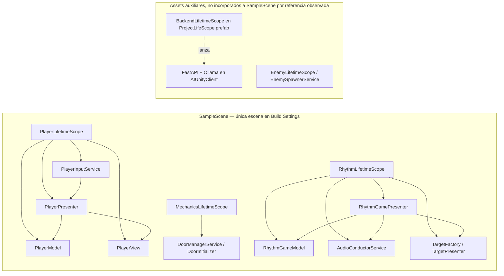

# Arquitectura actual de Mentality

## Plataforma y organización

Mentality es un proyecto de juego 3D de Unity `6000.3.2f1`, implementado principalmente en C# y renderizado con Universal Render Pipeline (`17.3.0`). La composición incluye VContainer, Input System (`1.17.0`), Cinemachine (`3.1.7`), UniTask, Newtonsoft Json y Unity Test Framework. El código ejecutable de Unity está bajo `Assets/Scripts`; el servicio auxiliar de IA/API está en `AIUnityClient/Api` y usa FastAPI, Pydantic, Ollama y Uvicorn.

El proyecto tiene módulos de juego separados por responsabilidad, pero no una Clean Architecture estricta: los modelos y presentadores de juego usan tipos de Unity, varios servicios acceden directamente al motor y la composición se define en `LifetimeScope` colocados en escenas. Las carpetas `Models`, `Views`, `Presenters`, `Services` y `Factories` describen roles reales, aunque no implican independencia del motor ni reglas de dependencias uniformes.

## Estructura de módulos

```text
Assets/
├── Scripts/
│   ├── Backend/                 # cliente HTTP, proceso Python, DTOs y scope opcional
│   ├── Enemy/Walker/            # spawn y comportamiento asíncrono de enemigos
│   ├── Mechanics/
│   │   ├── Factories/           # instanciación de objetivos rítmicos y presentadores de lockers
│   │   ├── Initializers/        # conexión inicial de puertas y lockers de escena
│   │   ├── Models/              # configuración, estado, beatmap y datos musicales
│   │   ├── Presenters/          # puertas, objetivos, reloj, HUD y generación rítmica
│   │   ├── Scopes/              # scopes de mecánicas generales y ritmo
│   │   ├── Services/            # audio/reloj, reglas, parsers, planificadores e interacción
│   │   └── Views/               # componentes Unity para puertas, objetivos y HUD
│   └── Player/                  # modelo, presenter, view, input y scope del jugador
├── Content/
│   ├── Scenes/                  # SampleScene (Build) y RhythmTest (fuera de Build)
│   ├── Prefabs/                 # objetivos, props, puertas y prefab ProjectLifeScope
│   ├── Music/                   # audio y MusicalSongAsset/mapas analizados
│   └── Prefabs/Rhythm/          # prefabs y recursos de palabras rítmicas
├── Editor/                      # constructores y comprobaciones de escena rítmica
├── InputSystem_Actions.inputactions
└── Settings/                    # configuración y perfiles de URP

AIUnityClient/
├── launcher.py                  # ejecuta Uvicorn con el directorio Api en sys.path
├── requirements.txt
└── Api/
    ├── main.py                  # aplicación FastAPI y lifecycle de Ollama
    ├── routers/                 # health, logs e interacción
    ├── models/                  # contratos Pydantic
    └── services/                # generación con Ollama y logging
```

En la estructura actual no hay código de UI propio bajo `Assets/Scripts/UI`, ni una escena UI incluida en Build Settings. La UI observable en `RhythmTest` es HUD de Unity UI (`RhythmHudView`), no el módulo UI Toolkit descrito en documentación anterior. Hay además contenido importado/de terceros y recursos auxiliares que no forman capas de lógica.

## Escenas y composición

`ProjectSettings/EditorBuildSettings.asset` incluye una sola escena: `Assets/Content/Scenes/SampleScene.unity`. Esta escena contiene `PlayerLifetimeScope`, `MechanicsLifetimeScope` y `RhythmLifetimeScope`, junto con las referencias serializadas de jugador y gameplay. La escena `RhythmTest.unity` existe, pero está excluida del build. Los scripts del Editor pueden generarla/configurarla para comprobaciones de juego.

`BackendLifetimeScope` está presente en el prefab `Assets/Content/Prefabs/ProjectLifeScope.prefab`, pero ese prefab no aparece referenciado por la escena incluida en Build Settings. Tampoco se encontró un `GameRootScope` activo en las escenas actuales. Por lo tanto, el grafo de composición comprobable para el juego publicado se limita a scopes de módulo en `SampleScene`; el backend no queda agregado automáticamente por la escena de Build.



El diagrama representa registros y dependencias definidos en código, no una validación de ejecución ni la presencia garantizada de cada componente en todas las configuraciones del Editor.

## Jugador e input

`PlayerLifetimeScope` registra las instancias serializadas de `PlayerView` y `PlayerModel`, registra `PlayerInputService` como singleton del scope y agrega `PlayerPresenter` como entry point scoped. El presenter implementa `IStartable` e `ITickable`: inicia el estado de cámara y coordina cada frame el movimiento, salto, gravedad, rotación, linterna, animación, perspectiva y raycasts de interacción. `PlayerInputService` crea `InputSystem_Actions`, habilita el mapa `Player` al inicializarse y lo deshabilita al destruirse.

`PlayerModel` conserva estado y parámetros editables, pero depende de `UnityEngine` (por ejemplo `Vector3` y hashes de Animator), por lo que no es un modelo de dominio aislado. `PlayerView` encapsula acceso a `CharacterController`, Animator, cámaras Cinemachine, cámara/ruido, cursor, luz y raycasts. La interacción rítmica del jugador se resuelve desde `PlayerPresenter` mediante la vista de objetivo y los presenters de mecánica; la vista hace raycast y delega el estado visual/temporal al componente de objetivo.

## Mecánicas de escena

### Puertas y lockers

`MechanicsLifetimeScope` registra referencias de escena (`Transform` del jugador, `DoorConfig`, `LockerInitializer`), `LockerFactory`, `DoorManagerService` y `DoorInitializer`. `DoorInitializer` busca las `DoorView` de la escena y las entrega al manager, que crea un `DoorPresenter` por puerta y activa una puerta disponible. Cada presenter conecta detección de proximidad y contacto; el contacto puede transportar temporalmente al jugador a un punto de aislamiento y devolverlo después de una espera asíncrona.

`LockerInitializer` es un `MonoBehaviour` con inyección por método. Busca `LockerView` y crea sus presenters con `LockerFactory`. La vista recibe interacciones físicas y comunica el uso del consumible; el flujo de consumo concreto se inicia desde los componentes de la escena y los prefabs correspondientes.

### Ritmo

`RhythmLifetimeScope` valida la configuración y el `playerTarget`, registra ambos como instancias, y compone `RhythmGameModel`, `AudioConductorService`, `TargetFactory`, `RhythmSpawnerPresenter` y `RhythmGamePresenter`. El HUD (`RhythmHudPresenter` y `RhythmSessionInputService`) solo se registra si `hudView` está asignada.

Al iniciar sesión, `RhythmGamePresenter` valida parámetros, carga y valida opcionalmente un mapa musical, prepara reloj/audio y agenda de aparición. En cada `Tick` sincroniza el reloj con la música y solicita al `RhythmSpawnerPresenter` tomar eventos vencidos. `MusicalSpawnSchedule` puede derivar eventos de mapas analizados con intervalos activos, intensidad, patrones y colocación; sin mapa, la generación sigue beats del `SongBeatmap`. `TargetFactory` instancia prefabs mediante VContainer, enlaza `TargetView` con `TargetPresenter` y limpia objetivos y aros al detener la sesión. `RhythmScoreRules`, `RhythmJudgmentWindows`, `RhythmPatternPlanner`, `RhythmPlacementPlanner`, `MusicalActivityProfile` y `MusicalMapLoader` concentran reglas y transformación de datos; varios siguen usando tipos de Unity/Newtonsoft en sus fronteras.

El objetivo (`TargetPresenter` + `TargetView`) avanza hacia el jugador, evalúa tiempo/distancia de impacto, registra aciertos/fallos en el modelo de sesión y puede cambiar movimiento por evasión cuando es apuntado. `RhythmHudPresenter` representa puntuación, combo y feedback, y toma entrada de sesión desde su servicio. Los datos de música analizada se representan con `MusicalSongAsset` y `MusicalMapData`; el parser valida tiempos, curvas, duración y correspondencia del clip.

### Enemigos

El módulo `Enemy/Walker` tiene `EnemyLifetimeScope`, `EnemySpawnerService`, `EnemyFactory`, `EnemyPresenter` y `EnemyView`. El scope recibe configuración y referencia al jugador; el registro `RegisterBuildCallback` resuelve el spawner e inicia un bucle UniTask que selecciona puntos suficientemente alejados y crea enemigos. Cada presenter elige un patrón de movimiento aleatorio y termina destruyendo su vista. No aparece un `EnemyLifetimeScope` en `SampleScene` o `RhythmTest`, así que el módulo está implementado como capacidad reutilizable, sin composición activa demostrada en esas escenas.

## Backend local de IA

El cliente C# del backend reside en `Assets/Scripts/Backend`. `ApiClient` usa `UnityWebRequest` y JSON para GET/POST a `http://127.0.0.1:8000`; `BackendLauncher` espera encontrar `AIUnityClient/venv/Scripts/python.exe`, inicia `launcher.py`, redirige salida a la consola Unity y espera indefinidamente una respuesta correcta de `/health`. `BackendPresenter` coordina inicio, espera y chequeo de estado. `BackendLifetimeScope` registra cliente, launcher y presenter, salvo que `BackendSceneSettings` marque la escena con backend desactivado.

El servidor Python expone `GET /health`, `POST /log`, `POST /gameplay/object-touch` y `POST /gameplay/touch-event`. El endpoint `object-touch` valida más de tres toques y devuelve cuatro coordenadas aleatorias; `touch-event` invoca `AIService`, que consulta el modelo Ollama `llama3` y valida la respuesta contra `AIResponseSchema`. `main.py` intenta iniciar Ollama y precargar el modelo al arranque de FastAPI.

La conexión de juego al backend está incompleta en el cableado observado: `TouchableObject` envía eventos a `/gameplay/object-touch`, no a `/gameplay/touch-event`, de modo que ese flujo no solicita el cálculo de Ollama. Además, `MechanicsLifetimeScope` registra `TouchableObject` pero no registra `IApiClient`; el scope que sí lo registra está en un prefab no referenciado desde la escena de Build. Es una brecha de composición estática que debe resolverse antes de considerar operativo el flujo de toque/API en `SampleScene`. El cliente C# y los modelos del contrato describen generación temporal de objetos, pero en esta escena no se confirmó una conexión efectiva entre ese flujo y el backend.

## Datos, recursos y configuración

Los prefabs de la mecánica rítmica y props están en `Assets/Content/Prefabs`; la música y assets de análisis bajo `Assets/Content/Music`; recursos de personaje, animaciones y materiales asociados con el jugador, bajo `Assets/Scripts/Player/Packages`. URP y perfiles de calidad están en `Assets/Settings` y `ProjectSettings`. Las acciones del jugador se describen en `Assets/InputSystem_Actions.inputactions`, y la referencia global del asset está configurada en `EditorBuildSettings.asset`.

## Verificaciones arquitectónicas estáticas

- El documento anterior `ARQUITECTURA_PROYECTO.md` y `ARQUITECTURA.md` describen un módulo UI Toolkit, escena `UIScene` y un scope raíz que ya no corresponden al `Assets/Scripts` ni al Build Settings actuales.
- `RhythmTest` y las comprobaciones asociadas a ritmo están excluidas del Build Settings. `Assets/Editor/RhythmTestSceneBuilder.cs` construye/configura la escena de pruebas y `RhythmTestPlayModeChecks.cs` contiene comprobaciones de Play Mode. Unity Test Framework está instalado; no se ejecutó el Editor ni se verificó aquí el resultado de esas comprobaciones.
- El proyecto tiene responsabilidades parcialmente separadas en presenters, views, servicios, fábricas y modelos, pero presenters y modelos de juego usan `UnityEngine`, y servicios pueden controlar directamente escena, procesos, audio, input y objetos.
- El sistema de interacción de backend utiliza un scope de prefab independiente y referencias configuradas por escena. No hay un composition root comprobado que lo enlace con el scope de mecánicas en `SampleScene`.

## Alcance de esta descripción

La arquitectura se reconstruyó mediante inspección estática de estructura y fuentes C#/Python, paquetes Unity, `ProjectVersion.txt`, `EditorBuildSettings.asset`, escenas, prefabs de scopes y scripts del Editor. No se abrieron escenas en Unity, no se ejecutó Play Mode, no se lanzó FastAPI/Ollama ni se ejecutaron builds o pruebas; por ello, el documento describe registros, referencias y llamadas declarados en los archivos, no comportamiento observado en tiempo de ejecución.
