# Arquitectura del proyecto Mentality

## Composición técnica

Mentality es un proyecto de juego 3D construido con Unity `6000.3.2f1`, C# y Universal Render Pipeline. La composición declarada incluye Input System `1.17.0`, Cinemachine `3.1.7`, VContainer, UI Toolkit y Unity Test Framework. Los archivos de solución y proyectos C# de la raíz sirven al Editor y al IDE; los módulos de comportamiento se encuentran en `Assets/Scripts` y `Assets/NPC`.

La estructura que existe combina scopes de escena de VContainer, un controlador del jugador organizado alrededor de Model–View–Presenter y una UI Toolkit conectada a Views, ViewModels, Services y Repositories. Los nombres de esas carpetas indican intención, pero el acoplamiento real se describe por las dependencias y llamadas observadas a continuación.

## Mapa de código y recursos

```text
Assets/
├── Scripts/
│   ├── Environment/
│   │   ├── GameRootScope.cs       # LifetimeScope declarado; no incluido en las escenas de Build
│   │   └── GameConfigSO.cs        # ScriptableObject de configuración sin campos propios
│   ├── Player/
│   │   ├── Models/                # PlayerModel y estado/configuración del movimiento
│   │   ├── Presenters/            # PlayerPresenter, coordinación por frame (ITickable)
│   │   ├── Scopes/Player/         # PlayerLifetimeScope
│   │   ├── Services/              # PlayerInputService e IPlayerInputService
│   │   ├── Views/                 # PlayerView, adaptador de componentes Unity
│   │   └── Packages/              # Modelo Erika Archer, materiales, texturas y animaciones
│   └── UI/
│       ├── Converters/            # MenuButton, SelectorButton, FormattedLabel y converter
│       ├── Handlers/              # UnityHandler y UnityHandler<T>, acciones invocables
│       ├── Models/                # MenuModel
│       ├── Repositories/          # Navegación UI, menú, opciones y botones
│       ├── Scopes/                # UILifetimeScope
│       ├── Services/              # Fachadas UI, menú, opciones y botones
│       ├── ViewModels/            # ViewModels del menú/opciones y base notificable
│       ├── Views/                 # BaseView, MenuView y OptionsView
│       └── UIDoc.cs               # Catálogo serializado de pantallas y bootstrap UI
├── NPC/Dialogue/                  # Dialogue ScriptableObject todavía aislado del flujo
├── Content/
│   ├── Scenes/                    # UIScene y SampleScene
│   ├── UI/Documents/              # UXML de menú, opciones, pausa y controles
│   ├── UI/Styles/                 # estilos USS
│   ├── Audio/, Fonts/, Sprites/   # recursos de presentación
│   └── Scriptable Objects/        # asset Audio
├── Settings/                      # assets y perfiles URP
├── InputSystem_Actions.inputactions
└── _Recovery/                     # escenas recuperadas; no incluidas en Build Settings
```

`Assets/TutorialInfo` y `Assets/UI Toolkit` contienen recursos auxiliares del proyecto/editor. No se encontraron prefabs, archivos `.asmdef` ni scripts de pruebas propios dentro de `Assets`; el manifiesto sí incluye el paquete de pruebas de Unity.

## Grafo de escenas y scopes

Build Settings habilita `UIScene` primero y `SampleScene` después. `UIScene` es la entrada: contiene `UIDocument`, `UIDoc`, las vistas serializadas de menú/opciones y `UILifetimeScope`. La acción Nueva partida carga `SampleScene` mediante `SceneManager.LoadScene("SampleScene")`. La escena de juego incluye el jugador, cámaras Cinemachine, cámara de render con Brain, linterna, volumen y `PlayerLifetimeScope` en el objeto `Setup`.

`GameRootScope` existe como clase, registra una instancia serializada de `GameConfigSO` y conserva como comentarios registros de sistemas aún no implementados. No aparece asociado a las escenas habilitadas. Por tanto, el grafo comprobable contiene un scope UI para `UIScene` y otro scope de jugador para `SampleScene`; no se observa un contenedor raíz compartido entre ambos.

```mermaid
flowchart TB
  subgraph U[UIScene — primera escena habilitada]
    ULS[UILifetimeScope]
    DOC[UIDoc + UIDocument]
    UIS[UIService]
    UIR[UIRepository]
    VIEW[MenuView / OptionsView]
    VM[MenuViewModel / MenuSettingsViewModel]
    MS[MenuService / MenuSettingsService]
    MR[MenuRepository / MenuSettingsRepository]
    UXML[UXML + USS]
    ULS --> UIS
    ULS --> UIR
    ULS --> VM
    DOC -->|Start registra catálogo| UIS
    UIS --> UIR
    UIR -->|instancia UXML e inyecta| VIEW
    VIEW -->|eventos de controles| VM
    VIEW --> UXML
    VM --> MS
    MS --> MR
    MR -->|solicita cambio de pantalla| UIS
  end
  subgraph G[SampleScene — escena de juego]
    PLS[PlayerLifetimeScope]
    IN[PlayerInputService]
    P[PlayerPresenter / ITickable]
    M[PlayerModel]
    V[PlayerView]
    E[CharacterController, Animator, cámaras, Light]
    PLS --> IN
    PLS --> P
    PLS --> M
    PLS --> V
    IN --> P
    P --> M
    P --> V
    V --> E
  end
  ROOT[GameRootScope: declarado, no asociado a estas escenas]
```



La navegación UI retorna al mismo `UIRepository` y cambia la pantalla dentro del `UIDocument`; la navegación a partida reemplaza la escena mediante la API de Unity. No hay evidencia en el cableado inspeccionado de persistencia de scopes UI o de un sistema global que coordine ambas escenas.

## Composición de dependencias con VContainer

### `UILifetimeScope`

Registra el `UIDoc` de escena como componente cuando la referencia no es nula. Registra `UIRepository`, `UIService`, repositorios y servicios de menú/opciones/botones como singletons dentro del scope. `MenuViewModel` se registra transient; `MenuSettingsViewModel` singleton; también se registra `UnityBaseViewModel` transient. Las vistas se conservan como componentes de escena en `ScreenEntry` y el `UIRepository` las inyecta explícitamente con `IObjectResolver.Inject` al cambiar a su pantalla.

El flujo de inicio parte de `UIDoc.Start()`, que llama `UIService.RegisterScreens(...)`. El repositorio almacena catálogo, `UIDocument` y raíz visual, y carga la pantalla inicial. El repositorio implementa `IInitializable`, pero su registro no está expresado como entry point y su `Initialize()` está vacío; el arranque de UI visible lo realiza `UIDoc`.

### `PlayerLifetimeScope`

Registra `PlayerView` y `PlayerModel` serializados como instancias. Registra `PlayerInputService` como singleton y `AsImplementedInterfaces()`, y a `PlayerPresenter` como entry point scoped. La interfaz de input es la dependencia que recibe el Presenter para leer controles; la vista y el modelo concretos se inyectan en el constructor del Presenter.

`PlayerInputService` implementa `IInitializable` y `IDisposable`. `Initialize()` habilita el mapa `Player` y `Dispose()` lo deshabilita. `PlayerPresenter` implementa `ITickable`, por lo que su `Tick()` se integra en el ciclo de actualización administrado por VContainer. Tiene también un método `Start()` con inicialización de cámaras, pero no implementa un contrato de inicio ni aparece llamado desde el scope; no se debe asumir que Unity lo invoca en esa clase C# ordinaria.

`MenuService` y `MenuSettingsService` implementan `IInitializable` y `IDisposable`, aunque sus registros son registrations regulares, no `RegisterEntryPoint`. Sus métodos de ciclo de vida están vacíos; el flujo de pantallas no depende de ellos para arrancar.

## Módulo del jugador

### Estado y entrada

`PlayerModel` contiene ajustes y estado mutable: velocidad, giro, gravedad, salto, perspectiva, linterna, amplitud de head bobbing, velocidad vertical y estado de suelo. Es serializable y la instancia llega desde el Inspector. No es un modelo C# independiente del motor: importa `UnityEngine`, usa `Vector3`, hashes de `Animator` y atributos de Inspector.

`InputSystem_Actions.inputactions` define mapas `Player` y `UI`, esquemas de control y bindings para teclado/ratón, gamepad, táctil, joystick y XR. El servicio de jugador habilita el mapa `Player` y expone movimiento, salto, linterna y cambio de cámara mediante `IPlayerInputService`; el botón derecho se consulta directamente por `Mouse.current`. El Presenter actualmente consume un subconjunto de las acciones declaradas; acciones como `Look`, `Attack`, `Interact`, `Sprint`, `Crouch`, `Previous`, `Next` y `Orbit` no tienen flujo expuesto por esa interfaz.

### Coordinación de movimiento

En cada `Tick`, `PlayerPresenter` procesa cambio de cámara, estado de suelo, órbita en tercera persona y linterna; calcula desplazamiento horizontal y vertical; mueve el `CharacterController`; y actualiza bobbing y parámetros del Animator. La primera persona alinea el cuerpo a la rotación de la cámara y mueve en los ejes del jugador. La tercera persona calcula orientación relativa a la cámara y suaviza el giro. Al activar tercera persona se apaga la linterna si estaba activa.

El Presenter no hereda de `MonoBehaviour`, pero conoce Unity a través de `Time`, `Vector2`, `Vector3`, `Mathf` y `Quaternion`; coordina la física, entrada y comportamiento de cámara. `PlayerView` es un `MonoBehaviour` que mantiene referencias serializadas al `CharacterController`, Animator, transform de cámara, cámaras de Cinemachine, controlador de ejes, ruido de cámara, renderer y luz. Expone métodos para aplicar prioridades de cámara, cursor, animaciones, linterna y head bobbing.

## Módulo de interfaz

### Registro y renderizado de pantallas

`UIDoc` serializa `initialScreen`, el `UIDocument` y una lista de `ScreenEntry`, cada uno con `ScreenType`, `VisualTreeAsset` y `BaseView` opcional. El enum contempla `MainMenu`, `Options`, `LoadData` y `Loading`; la escena registra las entradas disponibles en su Inspector. Al registrar, `UIRepository` retiene la raíz visual y cambia a la pantalla inicial.

Para cambiar pantalla, el repositorio localiza la entrada, limpia el árbol raíz, instancia su UXML y configura su tamaño. Luego conserva la `BaseView` serializada, la inyecta y llama `Initialize(screenInstance)`. `BaseView.Initialize` limpia sus enlaces anteriores, prepara elementos, registra (hoy inactivo) los hooks de hover y ejecuta `OnInitialize`/`OnBind`. El enlace de cancelación del mapa UI está comentado. `UIRepository.ChangeScreen` también contiene comentada la llamada que dispondría/desenlazaría la vista anterior antes de reemplazarla.

`MenuView` enlaza los botones de Nueva partida, Continuar, Ajustes y Salir con métodos/acciones del `MenuViewModel`. Continuar lee una lista de muestra e imprime nombres; no carga un guardado. `OptionsView` enlaza Regresar con `MenuSettingsViewModel`. Las plantillas UXML de opciones muestran pestañas de gráficos, audio e idioma; no se encontró un ViewModel de esas opciones ni código que las aplique o persista.

Los controles reutilizables incluyen `MenuButton`, `SelectorButton` y `FormattedLabel`. `SelectorButton` cambia su índice y texto visualmente, pero `ApplyLogic()` no está conectado a sus callbacks; los valores `onSelected` se conservan como datos y no ejecutan una configuración.

### Acciones y acceso a datos

`UnityHandler` y su variante genérica encapsulan un delegado y un `CanExecute` opcional, y actúan como comandos simples usados por los ViewModels. `UnityBaseViewModel` implementa notificaciones de propiedad para UI Toolkit, pero las clases actuales no muestran propiedades bindables que usen ese estado.

`MenuViewModel` delega a `MenuService`; `MenuService` delega a `MenuRepository` para iniciar partida, obtener guardados, navegar a opciones y salir. `MenuRepository` devuelve datos hardcodeados y llama directamente a `SceneManager`, `Application.Quit` y, en Editor, `EditorApplication`. `MenuSettingsRepository` cambia pantallas recibiendo `UIService`. Aunque se llaman repositories, estas clases también orquestan navegación y operaciones de plataforma.

`ButtonService` es una fachada de `ButtonRepository`. Los clips declarados no se reproducen actualmente; las suscripciones de hover están comentadas y varias rutas de sonido solo emiten advertencias. `BaseView` llama al registro alternativo de hover, pero eso no activa handlers mientras siga comentado en el repositorio.

## Diálogo NPC

`Assets/NPC/Dialogue/Dialogue.cs` declara un `ScriptableObject` que recorre secuencialmente `dialogueLines` y reinicia el índice al final. No se encontró un consumidor de `Dialogue` en scripts o escenas ni recursos de diálogo que lo conecten con el juego. Los campos que contendrían hablante y líneas no son públicos ni tienen `[SerializeField]`, así que no se ven editables desde el Inspector en la implementación actual.

## Recursos, escenas y render

`UIScene` usa UI Toolkit a través de `UIDocument`, `PanelSettings`, documentos UXML y hojas USS. `SampleScene` contiene cámaras de primera/tercera persona y Cinemachine Brain sobre la cámara de render, además del personaje importado con Animator, controlador y recursos visuales. Los assets incluyen perfiles/renderers URP separados para escritorio y móvil. Los recursos de UI, audio, tipografía e imágenes residen mayoritariamente en `Assets/Content`; el modelo, materiales, texturas y animaciones del personaje residen bajo `Assets/Scripts/Player/Packages`.

Algunos UXML guardan referencias `project://database/Assets/UI/...`, aunque los archivos correspondientes aparecen bajo `Assets/Content/UI/...`. Otros UXML sí usan la ruta `Assets/Content/...`. La referencia también contiene GUIDs, así que la lectura de texto por sí sola no permite concluir que Unity no pueda resolverlas; conviene validar esos documentos en UI Builder/Editor si aparecen referencias rotas.

En `UIScene.unity`, la cadena de clase serializada para el componente `MenuView` refleja un namespace anterior (`UnityUI.Views.MenuView`), mientras que el script actual declara `Mentality.UI.Views.MenuView`. La escena referencia el GUID del script. Es una discrepancia observable en metadatos YAML, no prueba por sí misma que el componente se pierda al cargar la escena.

## Límites de la arquitectura documentada frente a la implementada

- Clean Architecture, SOLID, MVP y MVVM aparecen como objetivos en `README.md`; el código implementa separación parcial de presentación, pero no capas independientes del motor. `PlayerModel` y `PlayerPresenter` dependen de Unity.
- El jugador se aproxima a MVP: el Presenter coordina un modelo mutable y una vista de Unity, aunque no toda la lógica puede probarse sin tipos del motor.
- La UI usa clases ViewModel y comandos, pero el enlace se realiza con callbacks de UI Toolkit y las operaciones de navegación/plataforma están en servicios/repositorios concretos. Esto corresponde a una separación de presentación parcial, no a un MVVM con estado bindable visible en uso.
- El scope raíz está preparado como punto de composición, pero no participa en las escenas Build habilitadas; configuración/servicios globales comentados no forman parte del grafo en ejecución demostrado.
- Los nombres `Repository` no garantizan persistencia: el menú devuelve registros simulados y no se observó implementación de guardado ni de opciones persistentes.

## Observaciones estáticas que afectan al flujo

1. En `MenuView.OnBind`, Ajustes y Salir se suscriben a `OpenSettingsCommand.Execute` y `ExitGameCommand.Execute`; `OnUnbind` intenta quitar delegates distintos (`OnSettingsClicked` y `OnExitClicked`). Por tanto, el desenlace no coincide con la suscripción. Sumado a que al cambiar pantalla no se limpia explícitamente la vista anterior, hay riesgo de conservar referencias y callbacks del árbol UXML retirado.
2. `PlayerPresenter.Start()` inicializa perspectiva de cámara, pero no está conectado explícitamente al ciclo de vida de VContainer ni llamado desde la composición. Las prioridades iniciales dependen así de los valores serializados de la escena hasta que cambie la perspectiva.
3. `Tick()` divide magnitud horizontal por `PlayerModel.MoveSpeed`, un valor editable. Si se configura como cero, la normalización puede producir un resultado no finito.
4. UI y jugador dependen de las referencias serializadas de sus escenas. La lectura estática confirma los componentes y campos del YAML, pero no valida que todas las referencias sean no nulas al ejecutar.
5. Los UXML de pausa, guardado y algunas opciones existen como recursos, pero no todos tienen una entrada configurada o un View/ViewModel conectado en la escena activa.

Estas observaciones son resultados de inspección estática. No implican que se haya ejecutado la escena o reproducido cada flujo.

## Alcance de verificación

Se inspeccionaron la estructura del repositorio, los scripts C# de `Assets/Scripts` y `Assets/NPC`, `README.md`, los documentos de arquitectura existentes, `Packages/manifest.json`, versión de Unity, Build Settings, acciones de Input System, UXML/USS y referencias serializadas de las escenas habilitadas. No se abrió Unity, no se ejecutaron escenas en Play Mode, no se compiló el juego ni se corrieron pruebas. La arquitectura descrita corresponde a las relaciones que se pueden confirmar en esos archivos.
