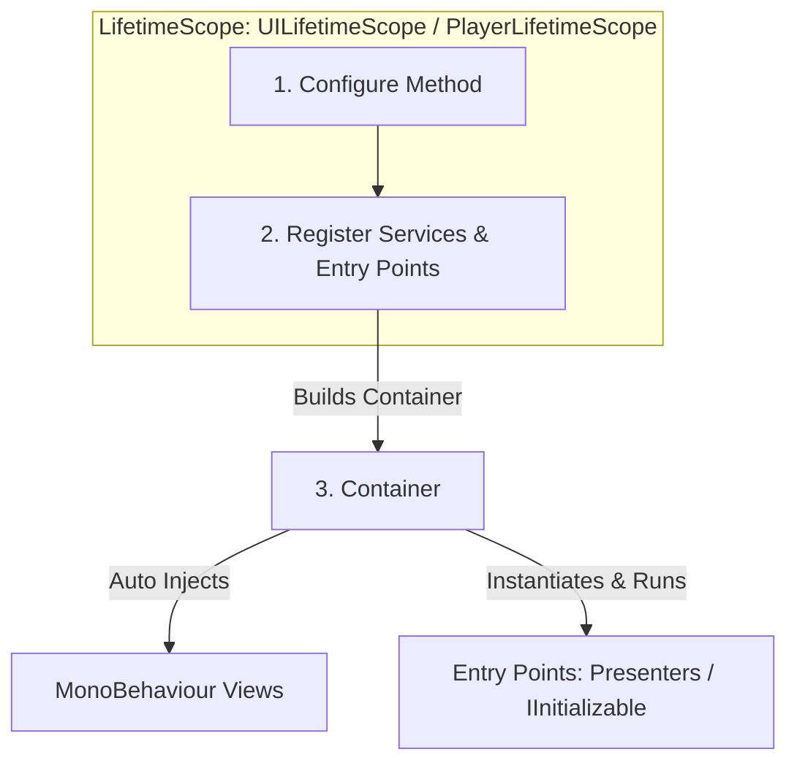
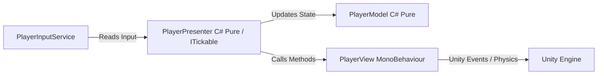
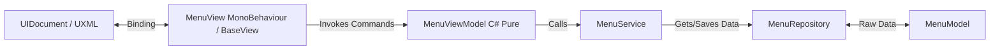

# Mentality - Arquitectura y Patrón de Diseño (Clean Architecture & SOLID)

Este proyecto está estructurado bajo los principios de **Clean Architecture**, **SOLID**, y patrones de presentación modernos (**MVP** y **MVVM**).

---

## 📂 Estructura del Proyecto

Las carpetas principales de código dentro de `Assets/Scripts/` se dividen de la siguiente manera:

```
Assets/Scripts/
├── Player/                   # Módulo completo del Jugador (Patrón MVP)
│   ├── Models/               # Estado, configuración de velocidad, gravedad, linterna (PlayerModel)
│   ├── Presenters/           # Cerebro del jugador (PlayerPresenter), C# puro que implementa ITickable
│   ├── Scopes/               # Ámbito de inyección de dependencias local (PlayerLifetimeScope)
│   ├── Services/             # Abstracción y servicio de entrada física (IPlayerInputService, PlayerInputService)
│   └── Views/                # Componentes físicos de Unity (PlayerView) que manejan cámaras y CharacterController
│
├── UI/                       # Módulo del Menú y la Interfaz de Usuario (Patrón MVVM/MVP)
   ├── Commands/             # Comandos genéricos de enlace de acciones (UnityCommand)
   ├── Models/               # Estructuras de datos para UI (MenuModel)
   ├── Repositories/         # Datos simulados o persistidos (MenuRepository, ButtonRepository)
   ├── Scopes/               # Ámbito de inyección de dependencias para la UI (UILifetimeScope)
   ├── Services/             # Servicios lógicos (MenuService, ButtonService)
   ├── ViewModels/           # Capa intermedia de estado de UI (MenuViewModel, UnityBaseViewModel)
   └── Views/                # Vistas enlazadas a UI Toolkit (MenuView, BaseView)
   └──UIDoc.cs              # Coordinador de escena que asocia ScreenEntries (ScreenType + UXML + BaseView)
```

---

## ⚡ Pilares de la Arquitectura Actual

### 1. Inyección de Dependencias (VContainer)
El proyecto utiliza **VContainer** para gestionar el ciclo de vida e inyectar dependencias automáticamente en lugar de usar Singleton globales o búsquedas costosas como `FindFirstObjectByType`.



*   **[UILifetimeScope](file:///d:/Github/Mentality/Assets/Scripts/UI/Scopes/UILifetimeScope.cs)**: Registra la vista de menú (`BaseView` / `MenuView`), repositorios, servicios y el `MenuViewModel`.
*   **[PlayerLifetimeScope](file:///d:/Github/Mentality/Assets/Scripts/Player/Scopes/Player/PlayerLifetimeScope.cs)**: Registra la vista (`PlayerView`), el modelo de datos (`PlayerModel`), la abstracción de entrada (`PlayerInputService`) y el presentador (`PlayerPresenter`).

### 2. Patrón MVP para el Jugador (Model-View-Presenter)
El flujo del jugador está desacoplado de `MonoBehaviour` usando puntos de entrada de VContainer:



*   **Model ([PlayerModel](file:///d:/Github/Mentality/Assets/Scripts/Player/Models/PlayerModel.cs))**: Clase C# pura que almacena velocidades, gravedad y estado de salto/linterna.
*   **View ([PlayerView](file:///d:/Github/Mentality/Assets/Scripts/Player/Views/PlayerView.cs))**: Componente MonoBehaviour que interactúa con `CharacterController`, `Animator` y `CinemachineCamera`.
*   **Presenter ([PlayerPresenter](file:///d:/Github/Mentality/Assets/Scripts/Player/Presenters/PlayerPresenter.cs))**: Clase C# pura. Implementa `ITickable` (involucrándose directamente en el `Update` de Unity gracias a VContainer). Traduce las entradas del `PlayerInputService` en comportamientos de movimiento y cámara, y actualiza el `PlayerModel` y la `PlayerView`.

### 3. Patron MVVM para la UI (Model-View-ViewModel)
El módulo de interfaz de usuario utiliza el patrón **MVVM** para separar la lógica de presentación del diseño visual en Unity (UI Toolkit):



*   **Model ([MenuModel](file:///d:/Github/Mentality/Assets/Scripts/UI/Models/MenuModel.cs))**: Representa los datos y el estado puro del juego (por ejemplo, información sobre si hay partidas guardadas). No conoce la existencia de la UI ni de los ViewModels.
*   **ViewModel ([MenuViewModel](file:///d:/Github/Mentality/Assets/Scripts/UI/ViewModels/MenuViewModel.cs))**: Es una clase C# pura encargada de procesar la lógica de la UI y exponer los comandos/operaciones (como `NewGame()`, `GetSaveData()`, `ExitGame()`). **No tiene dependencias de componentes de Unity** (`Button`, `VisualElement`), lo que facilita las pruebas unitarias automatizadas.
*   **View ([MenuView](file:///d:/Github/Mentality/Assets/Scripts/UI/Views/MenuView.cs))**: Formada por el diseño en UI Toolkit (`.uxml`/`.uss`) y la clase `MenuView`. Su única función es realizar el *binding* (enlace): asocia los elementos visuales del árbol UI (`root.Q<Button>("newBtn")`) con las interacciones del usuario y las delega directamente a las funciones lógicas del `MenuViewModel`.
*   **Coordinador ([UIDoc](file:///d:/Github/Mentality/Assets/Scripts/UI/UIDoc.cs) / [UIService](file:///d:/Github/Mentality/Assets/Scripts/Domain/Services/UIService.cs))**: Orquesta la instanciación de las vistas y de la transición entre pantallas (como cambiar del Menú Principal a Opciones) inyectando y montando los elementos visuales en el `UIDocument` de la escena.

---

## 🛠️ Aplicación de Principios SOLID

El proyecto es un excelente ejemplo práctico de SOLID:

1.  **S - Single Responsibility (Responsabilidad Única)**:
    *   `PlayerModel` solo contiene datos.
    *   `PlayerView` solo controla componentes de renderizado y físicas de Unity.
    *   `PlayerInputService` solo lee valores del nuevo *Input System*.
    *   `PlayerPresenter` se encarga exclusivamente de la lógica de negocio y enlace de los anteriores.
2.  **O - Open/Closed (Abierto/Cerrado)**:
    *   El sistema de pantallas (`UIService`) permite registrar nuevas vistas y tipos de pantallas (`ScreenType`) simplemente añadiéndolas al array de `UIDoc` en el Inspector de Unity, sin tener que modificar la clase principal de UI.
3.  **L - Liskov Substitution (Sustitución de Liskov)**:
    *   `MenuView` puede ser tratado indistintamente como un `BaseView` por el sistema de pantallas `UIDoc`, permitiendo inicialización genérica y registro de eventos de cancelación unificados.
4.  **I - Interface Segregation (Segregación de Interfaces)**:
    *   La entrada se abstrae bajo **[IPlayerInputService](file:///d:/Github/Mentality/Assets/Scripts/Player/Services/Interfaces/IPlayerInputService.cs)**, exponiendo únicamente propiedades de lectura de movimiento y botones, aislando la lógica del presentador del framework específico de entrada.
5.  **D - Dependency Inversion (Inversión de Dependencias)**:
    *   Los presentadores y viewmodels no instancian sus servicios con `new`. VContainer resuelve estas dependencias a través de inyección en constructor (`Constructor Injection`) o por método (`[Inject]`), dependiendo de abstracciones.

---

## 🧩 Paquetes/Frameworks utilizados

Se muestra un lista siguiente de los paquetes externos utilizados:

- **UI Toolkit Timeline** (`dev.krajnc.uitoolkittimeline`)
    - Integra el sistema de **Timeline** de Unity con la interfaz de usuario basada en **UI Toolkit**. Permite secuenciar, animar y controlar elementos de la interfaz mediante líneas de tiempo, facilitando la creación de transiciones y animaciones complejas.

- **VContainer** (`jp.hadashikick.vcontainer`)
    - Contenedor de **Inyección de Dependencias (Dependency Injection, DI)** de alto rendimiento para Unity. Favorece una arquitectura desacoplada, mejora la mantenibilidad del código y optimiza la gestión del ciclo de vida de las dependencias con un impacto mínimo en el rendimiento.

- **SceneRefAttribute** (`com.kylewbanks.scenerefattribute`)
    - Proporciona un atributo personalizado para el Inspector de Unity que permite asignar escenas mediante referencias seguras. Evita el uso de nombres de escenas escritos manualmente, reduciendo errores y facilitando el mantenimiento del proyecto.

- **Unity UI Toolkit Design System** (`com.sinanata.designsystem`)
    - Sistema de diseño desarrollado para **UI Toolkit** que ofrece componentes reutilizables, estilos consistentes y una estructura escalable para la construcción de interfaces de usuario. Facilita la implementación de una identidad visual uniforme en toda la aplicación.